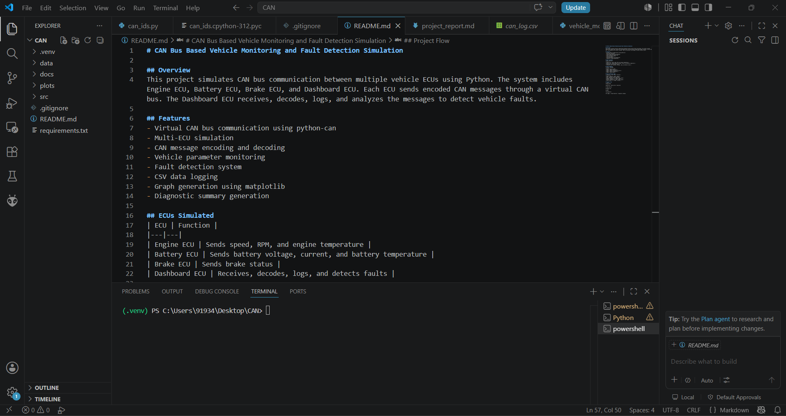
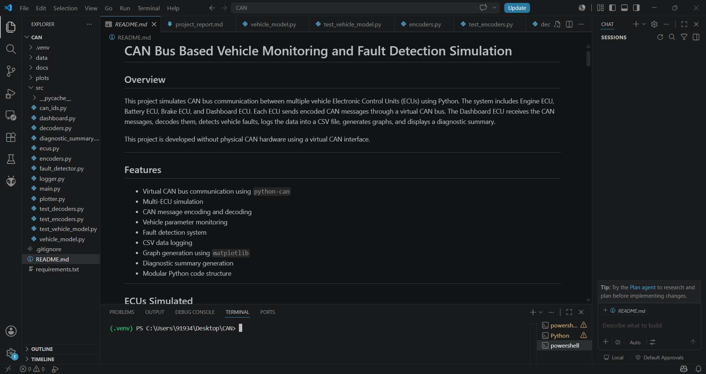
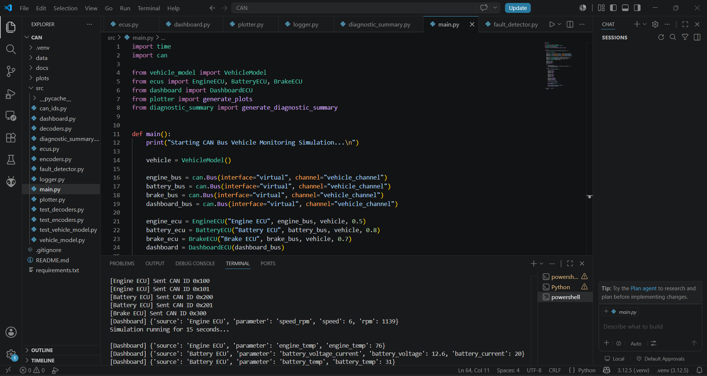
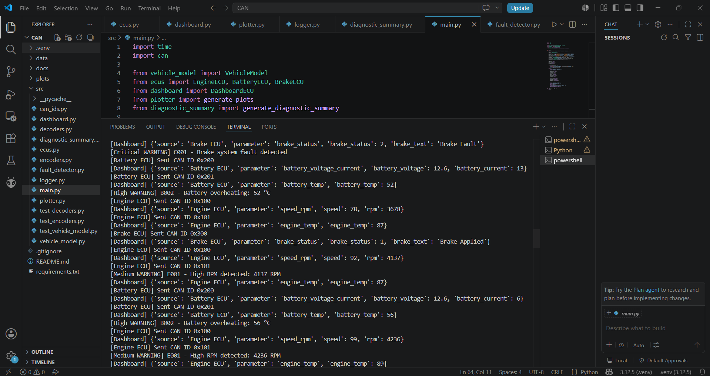
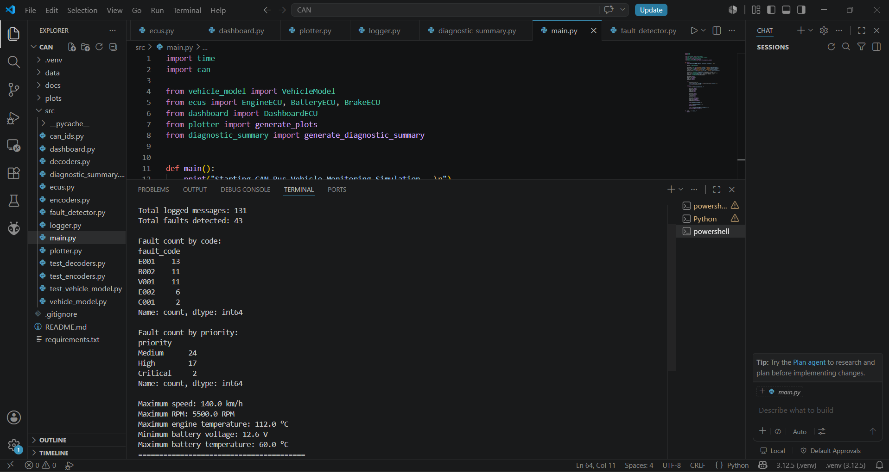
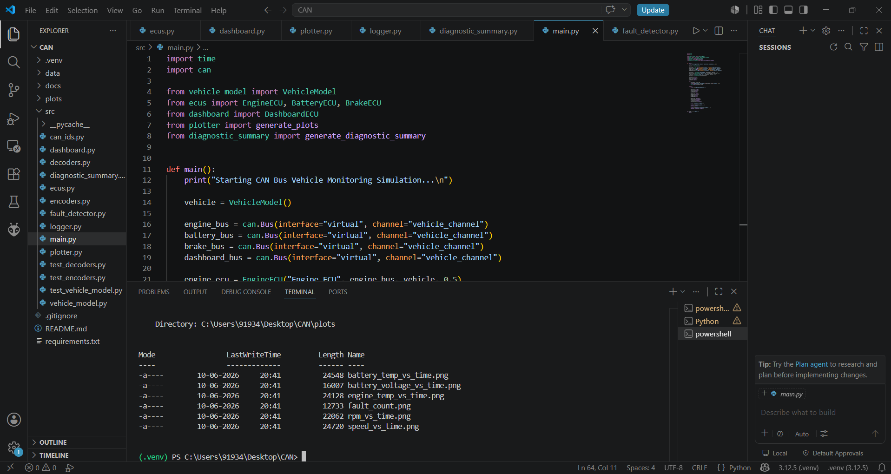
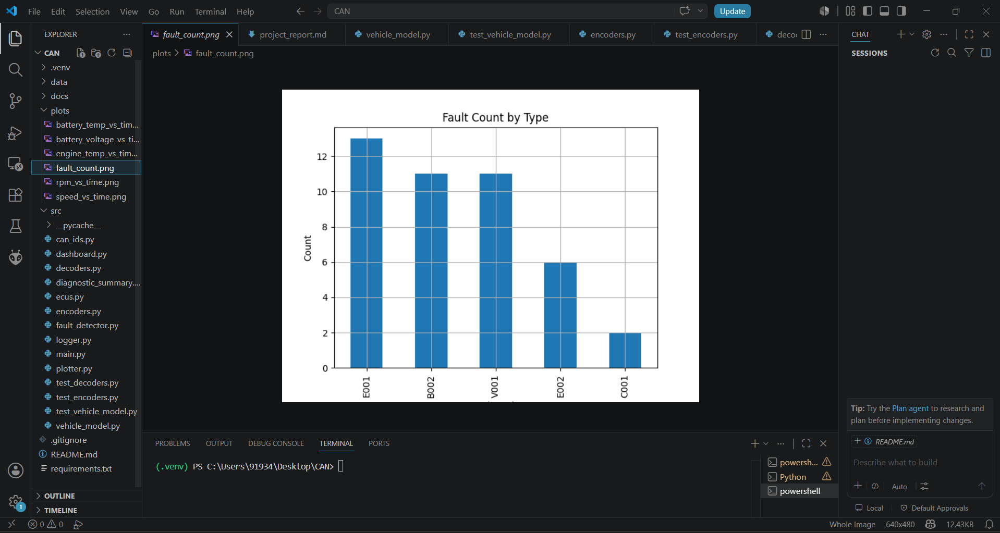
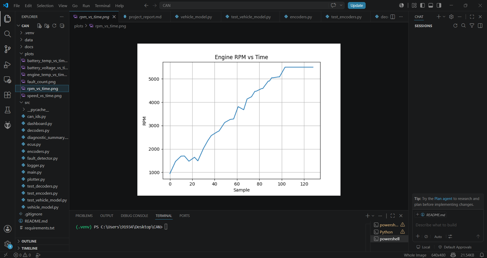
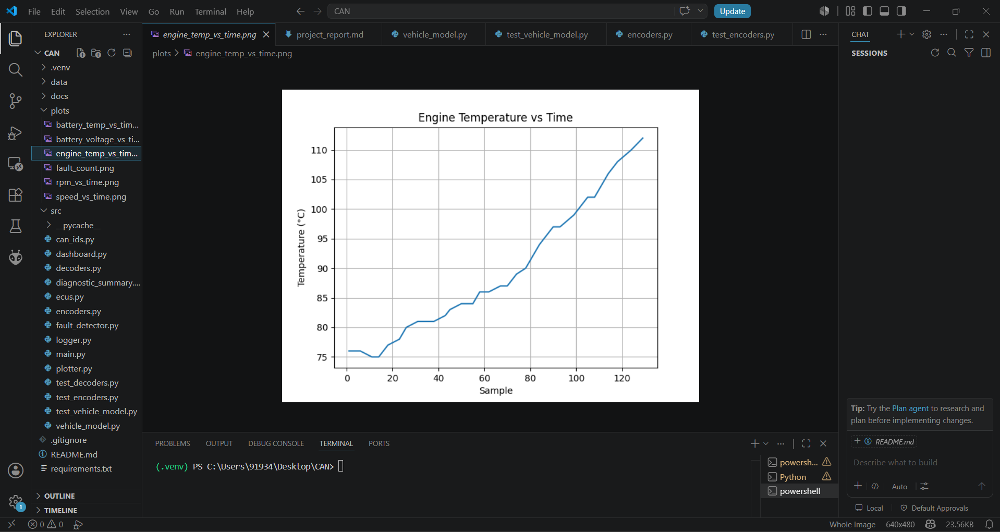
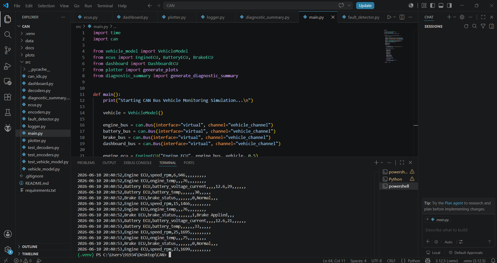

# CAN Bus Based Vehicle Monitoring and Fault Detection Simulation

## 1. Abstract

This project presents a software-based simulation of CAN bus communication for vehicle parameter monitoring and fault detection. The system simulates multiple vehicle Electronic Control Units (ECUs), including Engine ECU, Battery ECU, Brake ECU, and Dashboard ECU. The Engine ECU transmits speed, RPM, and engine temperature. The Battery ECU transmits battery voltage, battery current, and battery temperature. The Brake ECU transmits brake status.

All the ECU messages are encoded into CAN message format and transmitted through a virtual CAN bus using Python. The Dashboard ECU receives the messages, decodes the CAN data, detects abnormal vehicle conditions, logs the received data into a CSV file, generates graphs, and displays a final diagnostic summary. Faults such as overspeed, high RPM, engine overheating, battery overheating, low battery voltage, and brake system failure are detected using predefined threshold values.

This project is implemented without physical CAN hardware and is useful for understanding automotive communication, ECU interaction, CAN message encoding and decoding, and vehicle diagnostic concepts.

---

## 2. Introduction

Modern vehicles contain many Electronic Control Units (ECUs) to control and monitor different vehicle functions. Examples include Engine ECU, Battery Management System, Brake Control Unit, Transmission Control Unit, Airbag Control Unit, and Dashboard Control Unit. These ECUs need to exchange information continuously and reliably.

Controller Area Network (CAN) bus is widely used in automotive systems because it allows multiple ECUs to communicate with each other using message-based communication. Instead of using separate wires for every signal, CAN bus allows all ECUs to communicate through a common communication network.

In this project, a virtual CAN bus is created using Python. Different vehicle ECUs are simulated as software modules. Each ECU sends CAN messages with unique CAN IDs. The Dashboard ECU receives these messages, decodes the data, monitors vehicle conditions, and detects faults. This gives a practical understanding of how CAN communication works inside vehicles.

---

## 3. Objective

The main objective of this project is to simulate vehicle ECU communication using a virtual CAN bus and implement vehicle fault detection without using physical CAN hardware.

The specific objectives are:

* To simulate multiple vehicle ECUs using Python.
* To assign CAN IDs for different vehicle parameters.
* To encode vehicle data into CAN message format.
* To transmit messages through a virtual CAN bus.
* To decode received CAN messages into readable vehicle values.
* To detect faults using predefined threshold conditions.
* To log vehicle data and detected faults into a CSV file.
* To generate graphs from the logged data.
* To display a diagnostic summary after simulation.
* To understand automotive embedded communication concepts practically.

---

## 4. Need for CAN Bus in Vehicles

In a vehicle, many ECUs must communicate with each other in real time. For example, the dashboard needs speed data from the Engine ECU, battery data from the Battery ECU, and brake status from the Brake ECU. If separate wiring is used for every signal, the wiring system becomes complex, costly, and difficult to maintain.

CAN bus solves this problem by providing a common communication network for all ECUs. Each ECU sends messages with a unique identifier called a CAN ID. Other ECUs can receive and interpret the messages based on their IDs.

The main advantages of CAN bus are:

* Reduces wiring complexity.
* Supports real-time communication.
* Allows multiple ECUs to communicate on the same bus.
* Provides message priority using CAN IDs.
* Improves reliability in automotive environments.
* Supports fault detection and diagnostics.
* Makes vehicle systems easier to expand and maintain.

Because of these advantages, CAN bus is widely used in automotive embedded systems.

---

## 5. Existing System

In a real vehicle, ECU communication takes place using physical CAN hardware. Sensors collect data such as speed, RPM, temperature, voltage, current, and brake status. These sensor values are processed by ECUs and transmitted through the CAN bus. Diagnostic tools can be connected to the vehicle to monitor CAN messages and detect faults.

However, physical CAN hardware such as CAN transceivers, microcontrollers, CAN analyzers, and automotive sensors may not always be available for learning and development. This makes it difficult for students to practically understand CAN communication.

The limitations of the existing hardware-based approach are:

* Requires physical CAN hardware.
* Requires sensors and microcontroller boards.
* Increases cost.
* Hardware setup may be complex for beginners.
* Debugging hardware communication can be difficult.
* Fault testing may be risky in real vehicles.

To overcome these limitations, a software-based CAN simulation is developed in this project.

---

## 6. Proposed System

The proposed system is a Python-based virtual CAN bus simulation for vehicle monitoring and fault detection. Instead of using physical sensors and hardware ECUs, the system uses software modules to simulate vehicle behavior and ECU communication.

A vehicle model generates parameters such as speed, RPM, engine temperature, battery voltage, battery current, battery temperature, and brake status. These values are sent by virtual ECUs through a virtual CAN bus. The Dashboard ECU receives the CAN messages, decodes them, detects faults, logs data into a CSV file, and generates graphs.

The proposed system includes:

* Vehicle Model
* Engine ECU
* Battery ECU
* Brake ECU
* Dashboard ECU
* CAN Encoder
* CAN Decoder
* Fault Detector
* CSV Logger
* Graph Generator
* Diagnostic Summary Generator

The proposed system helps in understanding CAN communication without requiring physical hardware.

---

## 7. System Architecture

The system architecture consists of a vehicle model, multiple ECUs, virtual CAN bus, dashboard ECU, decoder, fault detector, CSV logger, graph generator, and diagnostic summary module.

```text
                 ┌──────────────────┐
                 │  Vehicle Model   │
                 └────────┬─────────┘
                          │
        ┌─────────────────┼─────────────────┐
        │                 │                 │
        ▼                 ▼                 ▼
 ┌─────────────┐   ┌─────────────┐   ┌─────────────┐
 │ Engine ECU  │   │ Battery ECU │   │  Brake ECU  │
 └──────┬──────┘   └──────┬──────┘   └──────┬──────┘
        │                 │                 │
        ▼                 ▼                 ▼
 ┌───────────────────────────────────────────────┐
 │              Virtual CAN Bus                  │
 └──────────────────────┬────────────────────────┘
                        │
                        ▼
              ┌─────────────────┐
              │  Dashboard ECU  │
              └────────┬────────┘
                       │
          ┌────────────┼────────────┐
          ▼            ▼            ▼
   ┌──────────┐  ┌────────────┐  ┌────────────┐
   │ Decoder  │  │Fault Check │  │ CSV Logger │
   └──────────┘  └────────────┘  └────────────┘
                                      │
                                      ▼
                              ┌────────────┐
                              │   Graphs   │
                              └────────────┘
                                      │
                                      ▼
                              ┌────────────┐
                              │  Summary   │
                              └────────────┘
```

The overall workflow is:

```text
Vehicle Model
     ↓
Generate vehicle parameters
     ↓
Engine ECU / Battery ECU / Brake ECU
     ↓
Encode data into CAN messages
     ↓
Transmit through virtual CAN bus
     ↓
Dashboard ECU receives messages
     ↓
Decode CAN messages
     ↓
Detect faults
     ↓
Log data into CSV
     ↓
Generate graphs
     ↓
Display diagnostic summary
```

---

## 8. CAN ID Mapping

Each vehicle parameter is assigned a unique CAN ID. The CAN ID helps the receiver identify the meaning of the message.

| CAN ID  | Message                     | Sender ECU  | Data Description                        |
| ------- | --------------------------- | ----------- | --------------------------------------- |
| `0x100` | Speed and RPM               | Engine ECU  | Byte 0 = Speed, Byte 1-2 = RPM          |
| `0x101` | Engine Temperature          | Engine ECU  | Byte 0 = Engine temperature             |
| `0x200` | Battery Voltage and Current | Battery ECU | Byte 0 = Voltage × 10, Byte 1 = Current |
| `0x201` | Battery Temperature         | Battery ECU | Byte 0 = Battery temperature            |
| `0x300` | Brake Status                | Brake ECU   | Byte 0 = Brake status                   |

Brake status values:

| Value | Meaning       |
| ----- | ------------- |
| 0     | Normal        |
| 1     | Brake Applied |
| 2     | Brake Fault   |

Example encoding:

```text
Speed = 80 km/h
RPM = 2500

RPM 2500 in hexadecimal = 0x09C4

CAN ID: 0x100
Data: [80, 0x09, 0xC4]
```

Battery voltage encoding:

```text
Battery voltage = 12.6 V
Stored value = 12.6 × 10 = 126

CAN Data = [126]
```

---

## 9. Software Requirements

The software requirements for this project are:

| Software / Library | Purpose                        |
| ------------------ | ------------------------------ |
| Python             | Main programming language      |
| VS Code            | Code editor                    |
| python-can         | Virtual CAN bus communication  |
| pandas             | Reading and analyzing CSV data |
| matplotlib         | Graph generation               |
| Windows PowerShell | Running commands and scripts   |

Python packages used:

```text
python-can
pandas
matplotlib
numpy
```

The required packages are stored in:

```text
requirements.txt
```

The project can be run using:

```bash
python src\main.py
```

---

## 10. Module Explanation

### 10.1 `main.py`

This is the main controller file of the project. It creates the vehicle model, virtual CAN buses, ECUs, and Dashboard ECU. It starts all ECU threads, runs the simulation for a fixed time, stops the simulation, shuts down the CAN buses, generates graphs, and displays the diagnostic summary.

Main functions:

* Starts simulation.
* Creates virtual CAN bus objects.
* Starts Engine ECU, Battery ECU, Brake ECU, and Dashboard ECU.
* Stops all ECUs safely.
* Generates plots.
* Prints diagnostic summary.

---

### 10.2 `vehicle_model.py`

This module generates virtual vehicle data. It simulates changing values for speed, RPM, engine temperature, battery voltage, battery current, battery temperature, and brake status.

Generated parameters:

* Speed
* RPM
* Engine temperature
* Battery voltage
* Battery current
* Battery temperature
* Brake status

Example output:

```text
VehicleState(speed=80, rpm=3200, engine_temp=90, battery_voltage=12.6, battery_current=25, battery_temp=38, brake_status=0)
```

---

### 10.3 `can_ids.py`

This module stores the CAN IDs used in the project. Keeping CAN IDs in one file makes the code clean and easy to modify.

Example:

```python
ENGINE_SPEED_RPM = 0x100
ENGINE_TEMPERATURE = 0x101
BATTERY_VOLTAGE_CURRENT = 0x200
BATTERY_TEMPERATURE = 0x201
BRAKE_STATUS = 0x300
```

---

### 10.4 `encoders.py`

This module converts normal vehicle values into CAN byte format.

For example, RPM may be greater than 255, so it is split into two bytes:

```text
RPM = 2500
Hex = 0x09C4
High byte = 0x09
Low byte = 0xC4
```

Battery voltage is scaled before sending:

```text
Battery voltage = 12.6 V
Stored value = 126
```

---

### 10.5 `decoders.py`

This module converts received CAN byte data back into readable values. The Dashboard ECU uses this module to understand received CAN messages.

Example:

```text
CAN ID: 0x100
Data: [80, 0x09, 0xC4]

Decoded:
Speed = 80 km/h
RPM = 2500 RPM
```

---

### 10.6 `ecus.py`

This module contains the virtual ECU classes. Each ECU runs as a separate thread and sends CAN messages at fixed intervals.

ECUs implemented:

| ECU         | Function                                                |
| ----------- | ------------------------------------------------------- |
| Engine ECU  | Sends speed, RPM, and engine temperature                |
| Battery ECU | Sends battery voltage, current, and battery temperature |
| Brake ECU   | Sends brake status                                      |

Using threads helps simulate multiple ECUs working at the same time.

---

### 10.7 `dashboard.py`

This module acts as the receiver ECU. It continuously listens for CAN messages from the virtual CAN bus. When a message is received, it decodes the message, checks for faults, prints the output, and logs the data.

Dashboard ECU workflow:

```text
Receive CAN message
     ↓
Decode message
     ↓
Detect fault
     ↓
Print output
     ↓
Log into CSV
```

---

### 10.8 `fault_detector.py`

This module checks whether the decoded vehicle data crosses safe threshold limits. If a value exceeds the limit, a fault warning is generated.

Example:

```text
Speed = 120 km/h
Threshold = 100 km/h

Fault: Overspeed detected
```

---

### 10.9 `logger.py`

This module stores all decoded vehicle data and detected faults in a CSV file. The CSV file is used later for graph generation and diagnostic summary.

Output file:

```text
data/can_log.csv
```

---

### 10.10 `plotter.py`

This module reads the CSV log file and generates graphs for different vehicle parameters.

Generated graphs:

* Speed vs Time
* RPM vs Time
* Engine Temperature vs Time
* Battery Voltage vs Time
* Battery Temperature vs Time
* Fault Count by Type

---

### 10.11 `diagnostic_summary.py`

This module reads the CSV file and prints a final summary after the simulation. It displays the total number of logged messages, total faults, fault count by code, fault count by priority, maximum speed, maximum RPM, maximum temperature, and battery voltage information.

---

## 11. Fault Detection Logic

Fault detection is performed using threshold-based conditions. When a decoded value crosses a predefined limit, a fault is generated.

| Fault Condition            | Fault Code | Priority | Description         |
| -------------------------- | ---------- | -------- | ------------------- |
| Speed > 100 km/h           | `V001`     | Medium   | Overspeed warning   |
| RPM > 4000 RPM             | `E001`     | Medium   | High RPM warning    |
| Engine Temperature > 100°C | `E002`     | High     | Engine overheating  |
| Battery Voltage < 11V      | `B001`     | High     | Low battery voltage |
| Battery Temperature > 45°C | `B002`     | High     | Battery overheating |
| Brake Status = 2           | `C001`     | Critical | Brake system fault  |

Example warning output:

```text
[Medium WARNING] V001 - Overspeed detected: 105 km/h
[Medium WARNING] E001 - High RPM detected: 4499 RPM
[High WARNING] B002 - Battery overheating: 52 °C
[Critical WARNING] C001 - Brake system fault detected
```

Fault priority levels:

| Priority | Meaning                                                 |
| -------- | ------------------------------------------------------- |
| Medium   | Warning condition that needs attention                  |
| High     | Serious condition that may affect system safety         |
| Critical | Dangerous fault condition requiring immediate attention |

---

## 12. Output Screenshots

### 12.1 Project Folder Structure



### 12.2 README Preview



### 12.3 CAN Message Transmission Output



### 12.4 Fault Warning Output



### 12.5 Diagnostic Summary



### 12.6 CSV Log Output



### 12.7 Fault Count Graph



### 12.8 Speed vs Time Graph



### 12.9 Temperature vs Time Graph



### 12.10 Additional Fault Output



## 13. Applications

This project has the following applications:

* Learning automotive CAN bus communication.
* Understanding ECU-to-ECU communication.
* Simulating vehicle monitoring systems.
* Understanding CAN message encoding and decoding.
* Demonstrating fault detection logic.
* Learning automotive diagnostics.
* Building a foundation for embedded automotive projects.
* Extending to Battery Management System communication.
* Preparing for final-year EV or automotive embedded projects.
* Demonstrating a software-only automotive simulation without hardware.

---

## 14. Future Scope

The project can be improved in the following ways:

* Add Tire Pressure Monitoring ECU.
* Add Fuel Level ECU.
* Add Door Status ECU.
* Add real-time GUI dashboard.
* Add DBC file support for realistic CAN decoding.
* Add real CAN hardware support using CAN transceiver modules.
* Add SocketCAN support on Linux.
* Add diagnostic trouble code history.
* Add live graph plotting.
* Add Battery Management System data.
* Transmit SOC and SOH values through CAN.
* Integrate with EV battery monitoring system.
* Add cloud logging for IoT-based vehicle monitoring.

The most useful future extension is to integrate this project with a Battery Management System. In that version, the BMS can estimate SOC and SOH and transmit battery health data through CAN to the dashboard.

---

## 15. Conclusion

This project successfully demonstrates a software-based CAN bus vehicle monitoring and fault detection system. Multiple virtual ECUs such as Engine ECU, Battery ECU, and Brake ECU transmit encoded CAN messages through a virtual CAN bus. The Dashboard ECU receives and decodes these messages, detects faults, logs data into a CSV file, generates graphs, and displays a diagnostic summary.

The project provides practical knowledge of CAN communication, ECU interaction, CAN message encoding and decoding, fault detection, data logging, and vehicle diagnostics. Since the system is implemented without physical CAN hardware, it is cost-effective and useful for learning automotive embedded system concepts.

This project can be further extended into a Battery Management System communication project by transmitting SOC, SOH, voltage, current, and temperature data through CAN bus.
